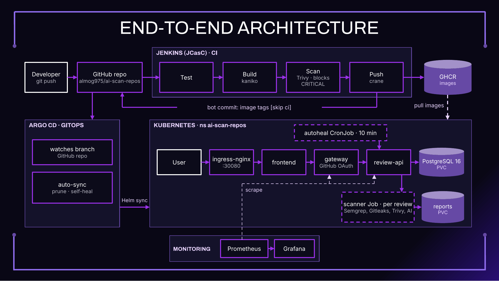

# AI Scan Repos

Technion DevOps final project.

The app lets you run a security review on a GitHub repository.

You sign in with GitHub, paste a repo URL, pick how deep the scan should go, and choose an AI provider.

The system then clones the repo, scans it, and shows a report in the browser, with optional AI explanations and suggested fixes.

This is also a full DevOps setup: the app runs on Kubernetes, Jenkins builds and tests the images, and Argo CD deploys them.

## What it does

After you start a review, review-api creates a short-lived Kubernetes Job.

That Job is the scanner-worker.

It clones the repository and runs Semgrep (code issues), Gitleaks (secrets), and Trivy (vulnerabilities and misconfiguration).

If an AI provider is configured, it reads the findings and the relevant code, then adds explanations and fix suggestions to the report.

There are three depths:

- `quick` — run the scanners and add a short AI summary
- `brief` — the AI looks at the top 10 findings, with code context
- `deep` — the AI looks at every code file, up to a limit of 40

You can pause a running review and resume it later.

Progress is saved after each file, so it doesn't start over.

If a Job gets stuck, a reconciler can launch it again.

The UI is in English and Hebrew.

Admins add the AI providers in the UI, as cloud or on-prem.

Cloud providers need an explicit acknowledgement, and those reports show a banner that a cloud model was used.

## Architecture



The browser talks to the frontend, which goes through the gateway.

The gateway handles GitHub login and sessions, then proxies API calls to review-api.

review-api is the core: it stores reviews and users in Postgres, keeps API keys encrypted, and starts one scanner Job per review.

Reports are written as `report.json` and `report.md` on a shared volume.

Around that, Jenkins tests the code, builds the images with kaniko, scans them with Trivy, and pushes them to GHCR.

A bot commit updates the image tags, and Argo CD syncs the cluster.

Prometheus and Grafana collect metrics, and a small auto-heal job restarts failed pods or resyncs Argo if something is stuck.

The code is grouped into `services/`, `infra/`, `ci/`, and `docs/`.

## Running it locally

### Docker Compose

Create a GitHub OAuth App with callback `http://localhost:8080/auth/github/callback`, then:

```bash
cp .env.example .env
# fill GITHUB_CLIENT_ID, GITHUB_CLIENT_SECRET, AI_KEYS_ENCRYPTION_KEY, and INTERNAL_API_TOKEN
docker compose up --build
```

Open http://localhost:8080 and sign in.

The first user becomes admin.

### Docker Desktop Kubernetes

If the images are already in GHCR (and the packages are public):

```powershell
kubectl apply -k infra/k8s/overlays/local-registry
kubectl -n ai-scan-repos port-forward svc/frontend 8080:8080
```

Then open http://localhost:8080.

How to set the GitHub OAuth and AI keys: [local secrets](docs/local-secrets.md).

Don't apply the `k3s` overlays on Docker Desktop.

To build the images yourself instead of pulling them:

```powershell
docker build -t ai-scan-repos-review-api:latest services/review-api
docker build -t ai-scan-repos-gateway:latest services/gateway
docker build -t ai-scan-repos-frontend:latest services/frontend
docker build -t ai-scan-repos-scanner-worker:latest services/scanner-worker
kubectl apply -k infra/k8s/overlays/local
kubectl -n ai-scan-repos port-forward svc/frontend 8080:8080
```

## CI/CD

On Docker Desktop, Jenkins watches the branch, runs the tests, builds the images with kaniko, scans them with Trivy (the build fails on HIGH or CRITICAL findings), and pushes to `ghcr.io/almog975/ai-scan-repos-<service>`.

A bot commit updates the image tags, and Argo CD syncs the cluster.

The full flow is in [CI/CD on Docker Desktop](docs/cicd-docker-desktop.md).

## Tests

```bash
make contracts
make test
```

## Docs

- [User guide](docs/user-guide.md)
- [CI/CD on Docker Desktop](docs/cicd-docker-desktop.md)
- [Local secrets](docs/local-secrets.md)
