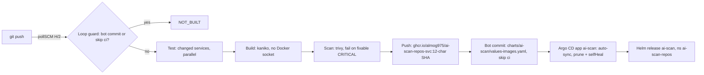

# AI Scan Repos

[](https://github.com/almog975/ai-scan-repos/actions/workflows/images.yml)

AI-assisted security review of GitHub repositories. A user logs in with GitHub, pastes a repo URL, and picks a depth and an AI provider. **review-api** then launches a short-lived **scanner-worker** Kubernetes Job (one per review). The Job clones the repo, runs **Semgrep, Gitleaks and Trivy**, optionally asks an AI model for explanations and fixes, and writes `report.json` / `report.md` to a shared reports volume. Reviews can be paused and resumed from a per-file checkpoint and recover automatically when a Job gets stuck.

Technion DevOps final project. Standalone repo `almog975/ai-scan-repos`; all paths are relative to the repo root ([ADR-0001](docs/adr/0001-repo-layout.md)). `contracts/` is the source of truth for APIs and schemas.

## Architecture



[architecture-v1.md](docs/diagrams/architecture-v1.md) (target, mermaid) · [architecture.md](docs/diagrams/architecture.md) (backend as built) · [review state machine](docs/diagrams/review-state-machine.md)

| Component | Path | Tech | Port | Role |
|---|---|---|---|---|
| frontend | `frontend/` | React + Vite → nginx-unprivileged | 8080 | SPA (English/Hebrew): new review, live progress, report, admin AI providers |
| gateway | `gateway/` | FastAPI | 8000 | GitHub OAuth, sessions + CSRF, `/me`, proxies `/api/*` to review-api with the internal token |
| review-api | `review-api/` | FastAPI, SQLAlchemy 2, Alembic, Postgres (SQLite in dev) | 8001 | Reviews, state machine, Job launcher, reconciler, reports, encrypted AI keys, `/metrics` |
| scanner-worker | `scanner-worker/` | Python (`python -m scanner.run --review-id X`) + semgrep, gitleaks, trivy | 8002 (probes) | Clone → scan → AI → report; checkpoint after each file |
| postgres | `deploy/postgres/` | PostgreSQL 16 | 5432 | Database |
| Helm chart | `charts/ai-scan/` | Helm 3 | – | **Primary deployment:** every service, Postgres, ingress, Secrets (placeholders), ServiceMonitors, alerts, dashboard, auto-heal RBAC ([chart README](charts/ai-scan/README.md)) |
| platform (legacy) | `deploy/platform/`, `deploy/*/overlays/` | Kustomize | – | Older Kustomize overlays (local, local-registry, k3s): reports PVC, ingress, NetworkPolicies, `reports-cleanup` CronJob |

**Depths:** `quick` = scanners + a short AI summary · `brief` = AI on the **top 10 findings** with code context · `deep` = AI on every code file (up to `DEEP_MAX_FILES`, 40).
**AI providers** are managed by admins. The DB `kind` (`onprem` | `cloud`) decides cloud vs on-prem. Cloud providers need `ack_cloud`, and their reports carry a cloud banner. Grok runs as `openai_compatible` with `https://api.x.ai/v1`, `kind: cloud`.
**Review states:** queued, running, paused, stuck, retrying, completed, failed, cancelled. Pause is allowed only from `running`; other states return 409.

## Quickstart

### Demo on Docker Desktop (recommended)

This is the setup used for the project demo: Docker Desktop Kubernetes, ingress-nginx on **NodePort 30080**, the
Helm chart [`charts/ai-scan`](charts/ai-scan/README.md) deployed by **Argo CD**, **Jenkins** for CI and
**kube-prometheus-stack** for monitoring. Setup, step by step: [docs/cicd-docker-desktop.md](docs/cicd-docker-desktop.md)
(prerequisites in [charts/ai-scan/README.md](charts/ai-scan/README.md), NodePort option B). Real GitHub OAuth and
AI key values go in two Secrets you create by hand: [docs/local-secrets.md](docs/local-secrets.md).

| What | URL | Login |
|---|---|---|
| App (frontend + gateway) | http://localhost:30080 | GitHub OAuth App, callback `http://localhost:30080/auth/github/callback` |
| Jenkins | http://jenkins.localhost:30080 | `admin`, password: `kubectl -n jenkins get secret jenkins -o jsonpath='{.data.jenkins-admin-password}' \| base64 -d; echo` |
| Argo CD | http://argocd.localhost:30080 | `admin`, password: `kubectl -n argocd get secret argocd-initial-admin-secret -o jsonpath='{.data.password}' \| base64 -d; echo` |
| Grafana | http://grafana.localhost:30080 | `admin` / `admin-local-dev-only` (local placeholder from `infra/helm/kube-prometheus-stack/values-local.yaml`) |

- **Jenkins:** job **AI Scan CI/CD (GitOps)** (`ai-scan-cicd`); open a build's **Pipeline Graph** view
  (pipeline-graph-view plugin) to see the per-service stages. The auto-heal job `ai-scan-autoheal` sits next to it.
- **Argo CD:** Application **ai-scan** (namespace `ai-scan-repos`), auto-sync with prune + selfHeal.
- **Grafana:** dashboard **AI Scan Repos**; **Explore** with the Prometheus data source for ad-hoc queries.
  (Loki/log search isn't installed in this stack; use `kubectl logs`.)

Chrome and Edge resolve `*.localhost` to 127.0.0.1. Otherwise: `curl -H "Host: jenkins.localhost" http://localhost:30080/`.

**Health check** (bash / WSL, `docker-desktop` context):
```bash
kubectl -n ai-scan-repos get pods                                   # all Running / Completed
curl -fsS http://localhost:30080/nginx-health; echo                 # frontend through ingress
kubectl -n argocd get application ai-scan \
  -o jsonpath='{.status.sync.status} {.status.health.status} {.status.sync.revision}{"\n"}'   # Synced Healthy <sha>
kubectl -n ai-scan-repos get deploy -o custom-columns=NAME:.metadata.name,IMAGE:.spec.template.spec.containers[0].image
curl -s -o /dev/null -w 'jenkins %{http_code}\n' http://jenkins.localhost:30080/login
curl -fsS http://grafana.localhost:30080/api/health; echo           # "database": "ok"
kubectl -n monitoring port-forward svc/kube-prometheus-stack-prometheus 9090 &   # then http://localhost:9090/targets
```

**Live GitOps loop demo** (about 5 minutes end to end):
1. Change visible text in `frontend/src` (e.g. the login page lead), then
   `git commit -am "demo(frontend): ..." && git push` to the branch Jenkins builds (`main` by default).
2. Within 2 minutes Jenkins (pollSCM) starts **AI Scan CI/CD (GitOps)**. Only `Test/Build/Scan/Push: frontend`
   run; the other services show as skipped.
3. The bot `ai-scan-ci-bot` commits `ci(gitops): frontend -> <sha> [skip ci]`, which changes only the `frontend:`
   line in `charts/ai-scan/values-images.yaml`. The next poll ends as NOT_BUILT (loop guard).
4. Argo CD syncs within about a minute; only the frontend Deployment rolls. Reload http://localhost:30080: the
   new text and `Version <sha>` appear.
5. Rollback: `git revert <bot-commit> && git push`. Argo CD deploys the previous tag; Jenkins builds nothing (no
   service folder changed).

Details and troubleshooting: [docs/cicd-docker-desktop.md](docs/cicd-docker-desktop.md) · scripted walkthrough:
[docs/runbooks/demo-script.md](docs/runbooks/demo-script.md).

### 1. Local (Python only, no OAuth, curl against review-api)

```bash
git clone https://github.com/almog975/ai-scan-repos.git && cd ai-scan-repos
python3 -m venv .venv && . .venv/bin/activate
pip install -r review-api/requirements.txt -r scanner-worker/requirements.txt   # includes semgrep
# gitleaks / trivy are used if on PATH, otherwise reported as "skipped"
export INTERNAL_API_TOKEN=dev-token AI_PROVIDER=none \
       REPORTS_DIR=$PWD/.local/reports WORK_DIR=$PWD/.local/work LOCAL_WORKER_CWD=$PWD/scanner-worker \
       DATABASE_URL=sqlite:///$PWD/.local/aiscan.db AI_KEYS_ENCRYPTION_KEY=$(openssl rand -hex 32)
mkdir -p .local
(cd review-api && uvicorn --factory app.main:get_app --port 8001) &   # port 8001: the local worker reports back here
```

review-api is internal: it expects `X-Internal-Token` and an existing user id in `X-User-Id` (the gateway normally
sets both). `app.devseed` creates a dev user (idempotent, SQLite only by default) and prints the curl headers:

```bash
H=$(cd review-api && python -m app.devseed alice)
ID=$(curl -s $H -X POST localhost:8001/reviews -d '{"repo_url":"https://github.com/OWASP/NodeGoat","depth":"quick"}' \
     | python -c 'import sys,json;print(json.load(sys.stdin)["id"])')
curl -s $H localhost:8001/reviews/$ID            # queued → running → completed
curl -s $H localhost:8001/reviews/$ID/report.md
```

(Verified 2026-10-28 with NodeGoat, `quick`: completed with a report.)

### 2. Docker Compose (full stack with UI)

Needs a GitHub OAuth App with callback `http://localhost:8080/auth/github/callback`.

```bash
cp .env.example .env     # fill GITHUB_CLIENT_ID/SECRET, AI_KEYS_ENCRYPTION_KEY=$(openssl rand -hex 32), INTERNAL_API_TOKEN
docker compose up --build   # AISCAN_HTTP_PORT (default 8080) and WORK_DIR are in .env
# open http://localhost:8080 → Log in with GitHub (the first user becomes admin)
```

Services: postgres → `migrate` (alembic) → review-api (local launcher, :8001 on localhost) → gateway (:8000) → frontend (:8080).

### 3. Local Kubernetes with the legacy Kustomize overlays (Docker Desktop or k3d)

> Sections 3–3b use the older Kustomize overlays (`deploy/overlays/*`). The primary deployment is the Helm chart
> [`charts/ai-scan`](charts/ai-scan/README.md); see [Demo on Docker Desktop](#demo-on-docker-desktop-recommended).

No registry, no manual secrets, no NetworkPolicies. PowerShell-friendly (no WSL required for this path).

```powershell
# from the repo root — build local tags (contexts = service dirs, same as Makefiles)
docker build -t ai-scan-repos-review-api:latest review-api
docker build -t ai-scan-repos-gateway:latest gateway
docker build -t ai-scan-repos-frontend:latest frontend
docker build -t ai-scan-repos-scanner-worker:latest scanner-worker
# k3d only (skip on Docker Desktop Kubernetes):
#   k3d image import ai-scan-repos-review-api:latest ai-scan-repos-gateway:latest ai-scan-repos-frontend:latest ai-scan-repos-scanner-worker:latest -c <cluster>
kubectl apply -k deploy/overlays/local
kubectl get pods -n ai-scan-repos
kubectl -n ai-scan-repos port-forward svc/frontend 8080:8080
# open http://localhost:8080
# GitHub OAuth App: Authorization callback URL = http://localhost:8080/auth/github/callback (exactly)
# migrate logs: kubectl -n ai-scan-repos logs job/review-api-migrate
# teardown:     kubectl delete -k deploy/overlays/local
```

Or skip the local builds and pull from GHCR (after the Images workflow has pushed and the
packages are Public): `kubectl apply -k deploy/overlays/local-registry`. Details:
[docs/local-k3d.md](docs/local-k3d.md#github-container-registry-deployoverlayslocal-registry).

Full notes (placeholders are NOT FOR PRODUCTION): [docs/local-k3d.md](docs/local-k3d.md#lightweight-overlay-deployoverlayslocal).

Auto-heal end to end on this stack (WSL / Git Bash): `ci/heal/e2e-local.sh`. One heal run: `kubectl -n ai-scan-repos create job --from=cronjob/ai-scan-autoheal heal-now` then `kubectl -n ai-scan-repos logs job/heal-now` (same commands in PowerShell). See [docs/local-k3d.md](docs/local-k3d.md#auto-heal-on-the-local-stack-end-to-end).

### 3a. Docker Desktop Kubernetes (no local builds)

```powershell
kubectl apply -k deploy/overlays/local-registry
kubectl -n ai-scan-repos port-forward svc/frontend 8080:8080   # open http://localhost:8080
```
Don't apply `deploy/*/overlays/k3s` on Docker Desktop (production mode, in-cluster registry, k3s-only API IP 10.43.0.1).
Troubleshooting for `SCANNER_IMAGE must be pinned`, `/readyz` Connection refused, and ImagePull errors:
[docs/local-k3d.md#docker-desktop-quickstart](docs/local-k3d.md#docker-desktop-quickstart-recommended-deployoverlayslocal-registry).

### 3b. Local Kubernetes via `make local-k8s` (k3d + registry + Argo CD)

```bash
cp .env.example .env     # INTERNAL_API_TOKEN >= 32 chars here
make local-k8s           # k3d cluster + registry, images, secrets from .env, deploy, Argo CD
# open https://ai-scan.localhost  (OAuth App callback: https://ai-scan.localhost/auth/github/callback)
make local-k8s-down
```

Uses `deploy/*/overlays/local` (k3d registry `:dev`), not `deploy/overlays/local`. Windows: run inside WSL2. Details: [docs/local-k3d.md](docs/local-k3d.md).

### 4. K3s (GitOps)

```bash
cp infra/installer/installer.env.example infra/installer/installer.env   # fill REPLACE_ME (never committed)
infra/installer/aiscan-install.sh --config infra/installer/installer.env --dry-run install
infra/installer/aiscan-install.sh --config infra/installer/installer.env install
```

`aiscan-install.sh` is a CLI (there is no web installer; the old web wizard was removed in Phase 9). It runs preflight → bootstrap → registry → secrets → images → deploy (Argo CD + app-of-apps) → verify. Details: [installer.md](docs/installer.md), [k3s.md](docs/k3s.md), [runbook](docs/runbooks/runbook.md).

### Tests

```bash
make contracts          # validate contracts/
make test               # every component (pytest / vitest), JUnit in <component>/reports/
cd frontend/e2e && python -m pytest -q   # Playwright e2e (mock stack); AISCAN_FULLSTACK=1 for the real stack
```

## CI/CD

The primary flow (verified on Docker Desktop) is Jenkins CI + GitOps with Argo CD. Jenkins builds and pushes images
and commits the new tag to git; it never runs `helm` or `kubectl` against the app. Only Argo CD deploys.



- **Trigger:** Jenkins job `ai-scan-cicd` ([`ci/cicd/Jenkinsfile.docker-desktop`](ci/cicd/Jenkinsfile.docker-desktop),
  defined in JCasC in [`deploy/jenkins/local/values-local.yaml`](deploy/jenkins/local/values-local.yaml)) polls
  GitHub every 2 minutes; a webhook can't reach a laptop.
- **Loop guard:** a commit by `ai-scan-ci-bot` or with `[skip ci]` ends the build as NOT_BUILT. Otherwise the build
  diffs against the last green commit and picks the changed service folders (`BUILD_ALL=true` builds all).
- **Per-service stages:** `Test: <svc>` in parallel (pytest / vitest), then `Build: <svc>` with kaniko and
  `Scan: <svc>` with trivy (sequential; `TRIVY_SEVERITY`, default `CRITICAL`, fixable only), then `Push: <svc>` to
  GHCR with crane. Nothing is pushed unless every scan passed.
- **GitOps:** `GitOps: commit` writes the new tag into `charts/ai-scan/values-images.yaml` (`[skip ci]`) and
  `GitOps: push` pushes it to the branch that was built (credential `github-push`). Argo CD Application
  **ai-scan** ([`deploy/argocd/docker-desktop/ai-scan.yaml`](deploy/argocd/docker-desktop/ai-scan.yaml)) renders
  `charts/ai-scan` with `values-docker-desktop.yaml` + `values-images.yaml` and syncs with prune + selfHeal.
- **Rollback:** `git revert` of the bot commit.

Full guide: [docs/cicd-docker-desktop.md](docs/cicd-docker-desktop.md).

### Images

| Service | GHCR package |
|---|---|
| frontend | [ghcr.io/almog975/ai-scan-repos-frontend](https://github.com/users/almog975/packages/container/package/ai-scan-repos-frontend) |
| gateway | [ghcr.io/almog975/ai-scan-repos-gateway](https://github.com/users/almog975/packages/container/package/ai-scan-repos-gateway) |
| review-api | [ghcr.io/almog975/ai-scan-repos-review-api](https://github.com/users/almog975/packages/container/package/ai-scan-repos-review-api) |
| scanner-worker | [ghcr.io/almog975/ai-scan-repos-scanner-worker](https://github.com/users/almog975/packages/container/package/ai-scan-repos-scanner-worker) |

Tag formats (two producers, both push to the same packages):
- **Jenkins (Docker Desktop GitOps):** the 12-character short git SHA, no prefix, e.g. `:78d37b6e094d`. Never
  `latest`. This is what `values-images.yaml` (and so Argo CD) deploys.
- **GitHub Actions** ([`.github/workflows/images.yml`](.github/workflows/images.yml)): `:sha-<7-char short SHA>`,
  e.g. `:sha-0588fd5`, plus `:latest`, on pushes to `main` that touch a service folder (pull requests only build). Used
  by the legacy `deploy/overlays/local-registry` overlay.

### Alternative: K3s / PR-based deploy

The original K3s flow uses the root [`Jenkinsfile`](Jenkinsfile) and the **legacy Kustomize overlays**
(`deploy/<component>/overlays/k3s`): Test (contracts, unit, schemathesis, DB parity) → kaniko Build → Trivy (HIGH/CRITICAL)
→ Push `<registry>/ai-scan/<svc>:<sha>` to the in-cluster registry → the tag bump goes to a `deploy/<svc>-<sha>`
branch with a PR (`[skip ci]`) that Almog merges → Argo CD app-of-apps `ai-scan-root` syncs `main`. It needs the
`github-bot` PAT ([deploy/jenkins/README.md](deploy/jenkins/README.md#github-bot-pat-deploy-pr-flow)). Docs:
[ci-cd-flow.md](docs/ci-cd-flow.md) · [ci.md](docs/ci.md) · [ci-cd.md](docs/ci-cd.md) · [ADR-0004 GitOps](docs/adr/0004-gitops.md) · [rollback](docs/runbooks/rollback.md)

**Auto-heal:** Jenkins job `ai-scan-autoheal` (every 10 min + Build Now, `DRY_RUN` parameter) deletes crashed/evicted pods, re-runs a failed migrate Job, restarts deployments failing `/readyz`, checks postgres and syncs OutOfSync Argo CD apps, with namespaced RBAC only ([docs/autoheal.md](docs/autoheal.md)).

## Documentation

| For | Docs |
|---|---|
| Users | [User guide](docs/user-guide.md) |
| Admins / operators | [Admin guide](docs/admin-guide.md) · [AI providers](docs/runbooks/admin-ai-providers.md) · [secrets](docs/secrets-runbook.md) · [local secrets (OAuth, AI key)](docs/local-secrets.md) · [monitoring](docs/monitoring.md) · [stuck review](docs/runbooks/stuck-review.md) · [rollback](docs/runbooks/rollback.md) · [storage](docs/storage-plan.md) |
| Demo | [Docker Desktop demo](#demo-on-docker-desktop-recommended) · [Live demo script](docs/runbooks/demo-script.md) · [Demo video script](docs/demo-video-script.md) |
| CI/CD + GitOps | [Docker Desktop CI/CD](docs/cicd-docker-desktop.md) · [local secrets (OAuth, AI key)](docs/local-secrets.md) · [Helm chart](charts/ai-scan/README.md) · [auto-heal](docs/autoheal.md) · [K3s flow](docs/ci-cd-flow.md) |
| Design | [ADRs](docs/adr/) · [report.md spec](docs/report-md-spec.md) · [severity mapping](docs/severity-mapping.md) · [contracts](contracts/README.md) |
| Everything | [docs/README.md](docs/README.md) |

Folder READMEs: [contracts](contracts/README.md) · [frontend](frontend/README.md) · [gateway](gateway/README.md) · [review-api](review-api/README.md) · [scanner-worker](scanner-worker/README.md) · [deploy](deploy/README.md) · [infra](infra/README.md)

## Status

**Done:**
- Phases 0–8: contracts, backend, scanner with AI, recovery and reconciler, frontend (English/Hebrew, accessibility checked), K3s overlays, CI build interface, monitoring, installer.
- Helm chart `charts/ai-scan` with auto-heal, Jenkins and Grafana on Docker Desktop.
- **CI/CD + GitOps loop verified end to end on Docker Desktop on 2026-11-09:** build-all run (tests, kaniko,
  trivy 0 CRITICAL, GHCR push, bot commit, Argo CD sync), a frontend-only change (only the frontend stages ran and
  only the frontend rolled), rollback by `git revert` of the bot commit, and the loop guard (bot commits end as
  NOT_BUILT). Monitoring up: Prometheus scraping all targets, Grafana "AI Scan Repos" dashboard showing data.

**Open:**
- PR #32: scanner-worker in the Jenkins pipeline (test/build/scan/push + `imageTags.scanner` bump) and the
  optional `scanner-ai` Secret for a default AI provider.
- After the open PRs merge: switch Jenkins `CICD_BRANCH` and the Argo CD `targetRevision` back to `main`
  ([how](docs/cicd-docker-desktop.md#after-the-branch-is-merged-back-to-main)).
- No tool to re-encrypt AI keys after rotating the master key ([ADR-0003](docs/adr/0003-ai-key-rotation.md), deferred).
- No automatic backups of reports or the database.
- Production secrets: Sealed Secrets or External Secrets instead of hand-made Secrets ([local-secrets.md](docs/local-secrets.md#4-production-dont-hand-create-secrets)).

More: [known-limitations.md](docs/known-limitations.md).
