# CI/CD + GitOps on Docker Desktop

```mermaid
flowchart LR
  dev[git push to GitHub] -->|Jenkins polls every 2 min| J[Jenkins job ai-scan-cicd]
  J --> T[test changed services]
  T --> B[kaniko build, no Docker socket]
  B --> S[trivy scan, fail on findings]
  S --> P[push ghcr.io/almog975/ai-scan-repos-svc:git-sha]
  P --> G[bot commit: charts/ai-scan/values-images.yaml, skip ci]
  G -->|Argo CD polls every ~1 min| A[Argo CD app ai-scan]
  A --> K[Helm release ai-scan in namespace ai-scan-repos]
```



- **Trigger:** pollSCM `H/2` (a GitHub webhook can't reach a laptop; see [Webhook instead of polling](#production-option-github-webhook-instead-of-polling)).
- **Build:** only the services whose folder changed (`frontend/`, `gateway/`, `review-api/`, `scanner-worker/`),
  or all of them with `BUILD_ALL`. Unit tests, then kaniko builds a tarball, trivy scans it, and crane pushes it. A test failure or
  a trivy finding (`TRIVY_SEVERITY`, default `CRITICAL`, fixable only) fails the build, so nothing is pushed.
- **Tag:** the 12-character git SHA. Never `latest`.
- **GitOps handoff:** the `ai-scan-ci-bot` commit sets the tag in `charts/ai-scan/values-images.yaml` with
  `[skip ci]`. The next poll sees the bot commit and ends as NOT_BUILT, so there's no loop.
- **Deploy:** only Argo CD deploys. The CI agent pod runs as ServiceAccount `jenkins/default`, which has no RBAC,
  and the pipeline never runs `helm` or `kubectl` against the app.
- **Scanner:** `scanner-worker` isn't a Deployment. review-api starts one Job per review with `SCANNER_IMAGE`,
  which the chart renders from `imageTags.scanner` into ConfigMap `scanner-image`. A bump changes that
  ConfigMap, its checksum annotation rolls review-api, and the next scan Job uses the new tag (running Jobs keep
  theirs).
- **Files:** `ci/cicd/Jenkinsfile.docker-desktop`, `deploy/jenkins/local/values-local.yaml` (job + pod
  template `ai-scan-ci`), `infra/argocd/values-docker-desktop.yaml`, `deploy/argocd/docker-desktop/ai-scan.yaml`,
  `charts/ai-scan/values-docker-desktop.yaml` and `charts/ai-scan/values-images.yaml`.

Prerequisites: everything from `charts/ai-scan/README.md`, i.e. ingress-nginx, kube-prometheus-stack, and Jenkins
from `deploy/jenkins/local/values-local.yaml`. Commands are bash (WSL Ubuntu), run from the repo root. The
URLs assume ingress-nginx on NodePort 30080; with the LoadBalancer on :80, drop `:30080`.

## 1. Tokens (you create them; they never go in git or in a chat)

| Jenkins credential ID | Kind | Token |
|---|---|---|
| `ghcr-push` | Username with password: `almog975` / token | GitHub **classic** PAT with `write:packages` (GHCR doesn't accept fine-grained tokens) |
| `github-push` | Username with password: `almog975` / token | Classic PAT with `repo` (what Lior uses), or a fine-grained PAT on `almog975/ai-scan-repos` only with *Contents: Read and write*. A 403 in the **GitOps** stage's push means the token can't write to the repo |

Jenkins > Manage Jenkins > Credentials > System > Global credentials > **Add Credentials**. The IDs must match
exactly. If `main` has branch protection that blocks direct pushes, the bot's push fails. In that case, allow
the token's user to bypass protection, or keep `main` unprotected for the course.

## 2. Jenkins: load the new job and pod template

```bash
helm upgrade --install jenkins jenkins --repo https://charts.jenkins.io --version 5.10.3 -n jenkins \
  -f deploy/jenkins/local/values-local.yaml --set controller.jenkinsUrl=http://jenkins.localhost:30080 \
  --wait --timeout 10m
```
After that, http://jenkins.localhost:30080 shows **AI Scan CI/CD (GitOps)** next to the auto-heal job.
The config-reload sidecar applies new JCasC within about a minute of the pod becoming ready. If the job still
isn't there, go to Manage Jenkins > Configuration as Code > **Reload existing configuration**.

The first build, and any build with no earlier green build, builds all four services. After that, each build
diffs against the last green build's commit. A push that changes no service folder ends as NOT_BUILT.

## 3. Argo CD

```bash
helm upgrade --install argocd argo-cd --repo https://argoproj.github.io/argo-helm --version 10.14.0 \
  -n argocd --create-namespace -f infra/argocd/values-docker-desktop.yaml --wait
kubectl -n argocd get secret argocd-initial-admin-secret -o jsonpath='{.data.password}' | base64 -d; echo
```
UI: http://argocd.localhost:30080, user `admin`.

## 4. Hand the `ai-scan` release from Helm to Argo CD

Argo CD renders the chart from git, so it can't see your gitignored `values.local.yaml` (the GitHub OAuth app).
That's why `values-docker-desktop.yaml` sets `secrets.create: false`, and the four Secrets stay out-of-band.
Real GitHub OAuth and AI key values go in two optional override Secrets, `gateway-oauth` and `scanner-ai`:
[local-secrets.md](local-secrets.md).

```bash
# Secrets: already in the cluster from the Helm install, so keep them. On a fresh cluster, create them once:
#   helm template ai-scan ./charts/ai-scan -n ai-scan-repos -f charts/ai-scan/values.local.yaml \
#     --show-only templates/secrets.yaml | kubectl -n ai-scan-repos apply -f -
kubectl -n ai-scan-repos get secret db-secrets ai-keys-master gateway-secrets scanner-secrets

# Make Helm forget the release WITHOUT deleting its resources (removes only Helm's release records).
# Don't use `helm uninstall`: it deletes the app.
kubectl -n ai-scan-repos delete secret -l owner=helm,name=ai-scan

# Argo CD adopts the same resources (same chart) and keeps them in sync with git.
kubectl apply -f deploy/argocd/docker-desktop/ai-scan.yaml
kubectl -n argocd get application ai-scan -w        # wait for Synced / Healthy
```
From here on, change the app through git, not `helm upgrade`. Argo CD's self-heal undoes manual changes.

## 5. Demo: change, push, deployed

```bash
# a visible change, e.g. a heading in frontend/src, then:
git commit -am "feat(frontend): demo change" && git push
```
1. Within 2 minutes Jenkins starts **ai-scan-cicd**, and the build description shows `frontend @ <sha>`. Stages:
   Checkout SCM, Loop guard, Test, Build, Scan, Push, GitOps. Inside them, `Test: <svc>` runs in parallel and
   `Build: <svc>`, `Scan: <svc>`, `Push: <svc>` run one at a time; services that didn't change show as skipped.
   The build's **Pipeline Graph** view (pipeline-graph-view plugin) shows those 7 top-level stages with the services nested;
   the classic Stage View table flattens every nested stage into its own column.
2. GitHub shows the commit `ci(gitops): frontend -> <sha> [skip ci]` by `ai-scan-ci-bot`. The next Jenkins poll
   ends as NOT_BUILT ("CI bot / [skip ci] commit").
3. Within about a minute Argo CD syncs:
   ```bash
   kubectl -n ai-scan-repos get deploy frontend -o jsonpath='{.spec.template.spec.containers[0].image}'; echo
   # ghcr.io/almog975/ai-scan-repos-frontend:<sha>
   curl -s http://localhost:30080/ | head
   ```

## 6. Rollback

- **Git (preferred):** revert the bot commit with `git revert <bot-commit> && git push`. Argo CD deploys the
  previous tag. Your revert has no `[skip ci]`, but it changes no service folder, so Jenkins builds nothing.
- **Argo CD:** pause auto-sync with `kubectl -n argocd patch application ai-scan --type merge -p
  '{"spec":{"syncPolicy":{"automated":null}}}'`, then use History and Rollback in the UI. Re-apply
  `deploy/argocd/docker-desktop/ai-scan.yaml` to turn auto-sync back on (git wins again).

## Testing a branch before it's merged

Both the job and the Application follow `main`. To try a branch end to end without touching `main`:
- **Jenkins:** add `--set controller.containerEnv[0].value=<branch>` to the Jenkins `helm upgrade` (sets
  `CICD_BRANCH`, default `main`). The job's branch and its BUILD_ALL / TRIVY_SEVERITY parameters are defined in
  JCasC, so restarts and config reloads keep them; don't edit them in Configure (a reload overwrites that).
  The bot pushes the tag bump back to the branch it built.
- **Argo CD:** `kubectl -n argocd patch application ai-scan --type merge -p '{"spec":{"source":{"targetRevision":"<branch>"}}}'`.

### After the branch is merged: back to `main`

While a PR branch is under test, Lior runs Jenkins with `CICD_BRANCH=<branch>` and the `ai-scan` Application with
`targetRevision: <branch>` (both set on the cluster, not in git). Once the PR is merged, point both back to `main`,
or the bot keeps committing to a dead branch and Argo CD keeps deploying it:
```bash
helm upgrade jenkins jenkins --repo https://charts.jenkins.io --version 5.10.3 -n jenkins \
  -f deploy/jenkins/local/values-local.yaml --set controller.jenkinsUrl=http://jenkins.localhost:30080 \
  --set controller.containerEnv[0].value=main --wait --timeout 10m
kubectl -n argocd patch application ai-scan --type merge -p '{"spec":{"source":{"targetRevision":"main"}}}'
```
Git already says `main` in both places (`deploy/jenkins/local/values-local.yaml`,
`deploy/argocd/docker-desktop/ai-scan.yaml`); this only undoes the on-cluster overrides. Then run **ai-scan-cicd**
once with `BUILD_ALL=true`, so `main` gets its own SHA tags.

## Production option: GitHub webhook instead of polling

Polling every 2 minutes works on a laptop because Jenkins makes the outgoing call. A webhook needs GitHub to
reach Jenkins, and `http://jenkins.localhost:30080` isn't reachable from the internet. On a server with a public
(or tunnelled) URL a webhook is better: builds start within seconds and Jenkins stops polling GitHub.

1. Jenkins: in the job DSL (`deploy/jenkins/local/values-local.yaml`, job `ai-scan-cicd`), replace
   `scmpoll_spec('H/2 * * * *')` with the GitHub push trigger (`githubPush()`; add the `github` plugin to `installPlugins`). Keep a slow poll
   (e.g. `H/15`) as a fallback if webhook deliveries can be lost.
2. GitHub: repo > **Settings > Webhooks > Add webhook**: Payload URL `https://<jenkins-host>/github-webhook/`,
   content type `application/json`, a secret, event **Just the push event**.
3. Laptop only, for a demo: expose Jenkins through a tunnel, e.g. `smee` (`smee -u https://smee.io/<channel>
   -t http://jenkins.localhost:30080/github-webhook/`) or `ngrok http 30080` (with the Host header set to
   `jenkins.localhost`). The tunnel URL changes per session, so polling stays the default here.

Argo CD has the same choice: it polls git every 3 minutes by default (every 60s here, `timeout.reconciliation` in
`infra/argocd/values-docker-desktop.yaml`), and a GitHub webhook to `https://<argocd-host>/api/webhook` makes it
sync immediately.

## Autoscaling (HPA)

`values-docker-desktop.yaml` turns on an `autoscaling/v2` HorizontalPodAutoscaler for **frontend**, **gateway** and
**review-api**: 1 to 3 replicas, 70% average CPU of the pod's request (100m for each, so about 70m). Postgres and
the scanner Jobs never scale. Keys per service in `charts/ai-scan/values.yaml` (`frontend`, `gateway`, `reviewApi`):

```yaml
autoscaling:
  enabled: false                    # chart default; true in values-docker-desktop.yaml
  minReplicas: 1
  maxReplicas: 3
  targetCPUUtilizationPercentage: 70
  # targetMemoryUtilizationPercentage: 80   # optional second metric, unset = CPU only
```
With `enabled: true` the Deployment has **no `spec.replicas`**, so the HPA owns the count and Argo CD has nothing to
diff (no `ignoreDifferences` needed). All three services are safe to run more than once: sessions live in Postgres,
and the review-api reconciler takes rows with `FOR UPDATE SKIP LOCKED`. Docker Desktop has a single node, so the
`reports` PVC (ReadWriteOnce) can be mounted by every review-api replica.

**metrics-server is required.** Docker Desktop doesn't ship it. Without it the HPAs show `<unknown>/70%`, never
scale, and Argo CD marks the `ai-scan` app **Degraded** (the HPA condition is `FailedGetResourceMetric`); the pods
keep running at 1 replica. Docker Desktop's kubelet uses a self-signed certificate, hence `--kubelet-insecure-tls`
(local only):
```bash
helm upgrade --install metrics-server metrics-server --repo https://kubernetes-sigs.github.io/metrics-server/ \
  --version 3.14.0 -n kube-system --set 'args={--kubelet-insecure-tls}' --wait
kubectl top nodes                      # works after ~1 minute
```

**Verify:**
```bash
kubectl -n ai-scan-repos get hpa                    # TARGETS cpu: 3%/70%, MINPODS 1, MAXPODS 3, REPLICAS 1
kubectl -n ai-scan-repos top pods
kubectl -n ai-scan-repos get deploy gateway -o jsonpath='{.spec.replicas}{"\n"}'   # set by the HPA
```

**Load test** (gateway 1 → 3 → 1). Eight busybox loops hit the gateway Service from inside the cluster:
```bash
kubectl -n ai-scan-repos run hpa-load --image=busybox:1.36 --restart=Never -- /bin/sh -c \
  'for i in 1 2 3 4 5 6 7 8; do (while true; do wget -q -O /dev/null http://gateway:8000/healthz; done) & done; sleep 600'
kubectl -n ai-scan-repos get hpa gateway -w          # CPU climbs past 70%, REPLICAS 1 -> 2 -> 3 within ~1-2 min
kubectl -n ai-scan-repos get pods -l app=gateway     # in a second terminal
kubectl -n ai-scan-repos delete pod hpa-load         # stop the load
kubectl -n ai-scan-repos get hpa gateway -w          # back to 1 after the 5-minute scale-down window
```
For the frontend use `http://frontend:8080/` in the loop and watch `hpa frontend`. To turn autoscaling off again,
set `<svc>.autoscaling.enabled: false` in `values-docker-desktop.yaml` and push; the Deployment gets
`replicas: <svc>.replicas` (1) back.
