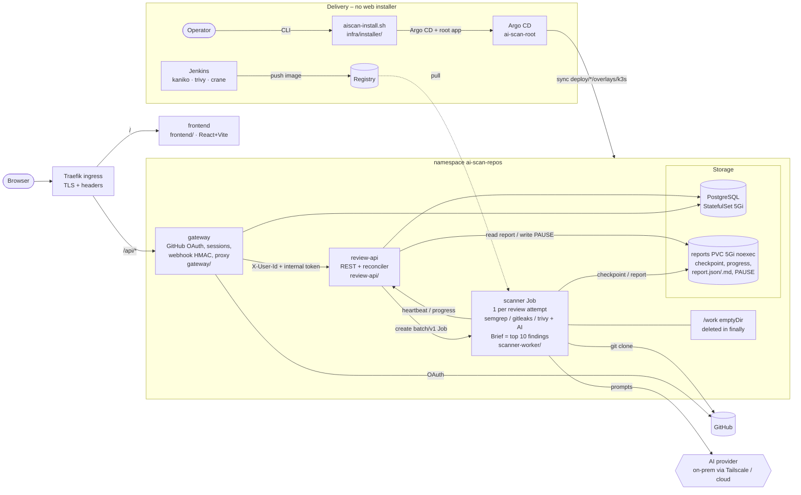

# Architecture v1 (target, per plan)

Repo `almog975/ai-scan-repos`, folders at the repo root (see [ADR-0001](../adr/0001-repo-layout.md)).
`contracts/` is the source of truth for APIs and schemas; where code differs, the code must change to
follow the contracts. Exception adopted into the plan: **Brief depth sends the top 10 findings
(with code context) to the AI**, as the code does today.

Target architecture from the AI Scan Planner plan. Solid edges = request/data flow. Each box names its monorepo folder; manifests live in `deploy/<component>/`. Rendered: [architecture-v1.svg](architecture-v1.svg).

| Component | Plan | Folder |
|---|---|---|
| Traefik | IngressRoute `/`→frontend, `/api`→gateway | `deploy/` (ingress) |
| frontend | SPA, progress, report, settings | `frontend/` (React+Vite) |
| gateway | OAuth, `/me`, webhooks, proxy | `gateway/` |
| review-api | REST, reconciler, Job creation | `review-api/` |
| scanner Job | per review | `scanner-worker/` |
| PostgreSQL | StatefulSet 5Gi | `deploy/` + `infra/db/` |
| reports PVC | 5Gi, `noexec,nosuid,nodev` | `deploy/` |
| contracts | OpenAPI + JSON schemas | `contracts/` |

Delivery: the operator runs the CLI installer `infra/installer/aiscan-install.sh` (no web UI; the former web wizard on port 8088 was removed in Phase 9), which installs Argo CD and the app-of-apps. Jenkins builds, scans and pushes images; Argo CD syncs `deploy/<component>/overlays/k3s` from `main` ([ci-cd-flow.md](../ci-cd-flow.md)). Tag bumps reach `main` as automatic Jenkins PRs that Almog merges.

See also: [architecture.md](architecture.md) (as-built, Phase 1 backend), [ADR-0001](../adr/0001-repo-layout.md), [ADR-0002](../adr/0002-k8s-job-per-review.md).
