# Review state machine

Source: `review-api/app/state.py` (`TRANSITIONS`, `MAX_ATTEMPTS = 5`), `app/watchdog.py`, `app/service.py`,
`app/routers/reviews.py`, `app/routers/control.py` on `feat/phase-2-scanner` (14e5a55). Paths are review-api paths;
through the gateway prefix them with `/api`. Illegal transitions return **409 CONFLICT**.
Transitions allowed by `TRANSITIONS` but with no code path that triggers them are marked **pending**.

```mermaid
stateDiagram-v2
    [*] --> queued: POST /reviews (row created)
    queued --> running: POST /reviews — start_attempt(mark_running=True), same request
    queued --> running: first heartbeat — POST /internal/reviews/{id}/progress (after resume)
    queued --> paused: POST /reviews/{id}/pause
    queued --> cancelled: POST /reviews/{id}/cancel
    queued --> failed: pending (no trigger; watchdog does not sweep queued)
    running --> paused: POST /reviews/{id}/pause (Job deleted)
    running --> stuck: watchdog — no heartbeat 900s / Job failed or missing / outcome=error
    running --> completed: worker outcome=success — POST /internal/reviews/{id}/progress
    running --> cancelled: POST /reviews/{id}/cancel
    running --> failed: pending (code always goes via stuck)
    stuck --> retrying: watchdog relaunch, attempt n+1 (same sweep)
    stuck --> failed: watchdog — 5 attempts exhausted
    stuck --> queued: POST /reviews/{id}/resume (attempt n+1)
    stuck --> cancelled: POST /reviews/{id}/cancel
    retrying --> running: first heartbeat — POST /internal/reviews/{id}/progress
    retrying --> retrying: watchdog relaunch, attempt n+1
    retrying --> failed: watchdog — 5 attempts exhausted
    retrying --> paused: POST /reviews/{id}/pause
    retrying --> cancelled: POST /reviews/{id}/cancel
    paused --> queued: POST /reviews/{id}/resume (same attempt, own checkpoint)
    paused --> running: pending (allowed, no trigger)
    paused --> cancelled: POST /reviews/{id}/cancel
    failed --> retrying: POST /reviews/{id}/retry (budget_no+1, attempt 1)
    completed --> [*]
    cancelled --> [*]
```

| From | To | Trigger | Component / endpoint | Side effects | Status |
|---|---|---|---|---|---|
| — | queued | user creates review | `POST /reviews` | commit_sha resolved and pinned; 409 if an active review exists for repo+sha; capacity check | ✅ |
| queued | running | Job launched in the create request | `POST /reviews` → `start_attempt(mark_running=True)` | attempt 1 row, `last_heartbeat=now` | ✅ (not on heartbeat) |
| queued | running | first worker heartbeat | `POST /internal/reviews/{id}/progress` | `last_heartbeat` | ✅ |
| queued/running/retrying | paused | user | `POST /reviews/{id}/pause` | Job deleted; attempt stays open; `paused_at` | ✅ |
| running | stuck | heartbeat older than `HEARTBEAT_TIMEOUT_SECONDS` (900), Job `failed` (backoffLimit 0, `activeDeadlineSeconds` 21600) or `missing`, or worker `outcome=error` | watchdog `sweep()` every 60 s | attempt ends `stuck`; Job deleted (Background) | ✅ (transient) |
| stuck | retrying | attempts left | watchdog `relaunch()` same sweep | attempt n+1 launched | ✅ |
| retrying | retrying | attempt n+1 also stuck | watchdog | attempt n+2 launched | ✅ |
| stuck/retrying | failed | attempt 5 stuck | watchdog | `failure_reason` "5 attempts exhausted…"; per-review AI Secret deleted | ✅ |
| retrying | running | first heartbeat | internal progress | | ✅ |
| running | completed | `outcome=success` + `report.json` present | internal progress | summary stored; AI Secret deleted | ✅ |
| paused | queued | user | `POST /reviews/{id}/resume` | capacity check; same attempt relaunched from its checkpoint | ✅ |
| stuck | queued | user | `POST /reviews/{id}/resume` | attempt n+1 | ✅ code, rarely reachable (stuck is transient) |
| failed | retrying | user | `POST /reviews/{id}/retry` | `budget_no+1`, attempt 1, new Job | ✅ |
| any active | cancelled | user | `POST /reviews/{id}/cancel` | Job deleted; attempt `cancelled`; AI Secret deleted | ✅ |
| queued | failed | — | — | — | **pending** |
| running | failed | — | — | — | **pending** (via stuck only) |
| paused | running | — | — | — | **pending** |

## Where code and plan differ
1. **`stuck` is transient.** The watchdog moves `running → stuck → retrying` (or `failed`) in one sweep, so
   clients almost never see `stuck`, and `resume` from `stuck` is practically unreachable.
2. **`queued` is not watched.** `sweep()` only checks `running`/`retrying`. A review resumed to `queued` whose
   Job dies before its first heartbeat stays `queued` forever (see [stuck-review runbook](../runbooks/stuck-review.md)).
3. **Create skips `queued`:** `POST /reviews` marks the review `running` at Job launch, not on the first heartbeat
   (resume/retry wait for the heartbeat).
4. Allowed but untriggered: `queued→failed`, `running→failed`, `paused→running`.
5. No endpoint forces `failed` (only `cancel`). Admins can call the owner endpoints on any review
   (`get_review` lets `role=admin` through); marking `failed` by hand needs SQL.
6. A retrying review that gets stuck again has no `retrying→stuck` step; attempts are counted only in `review_attempts`.
