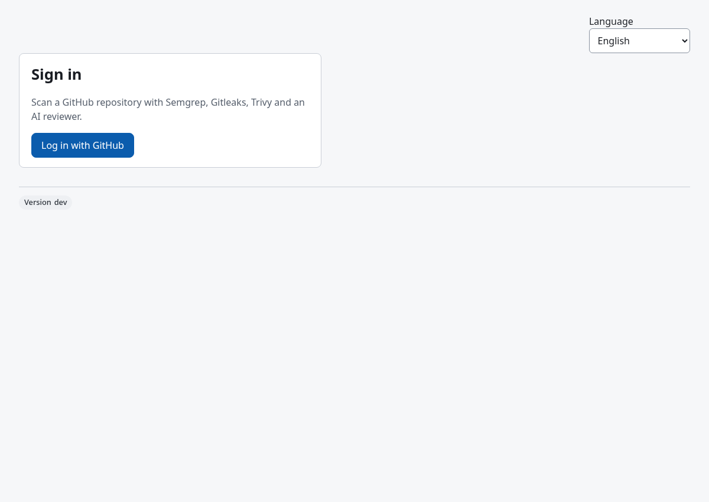
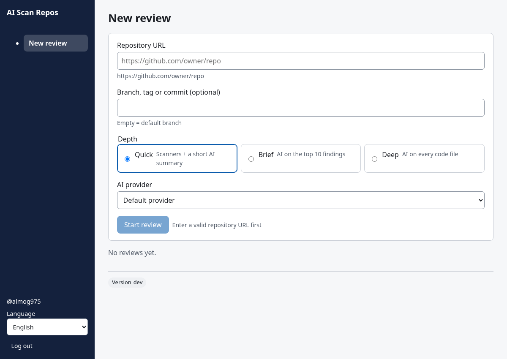
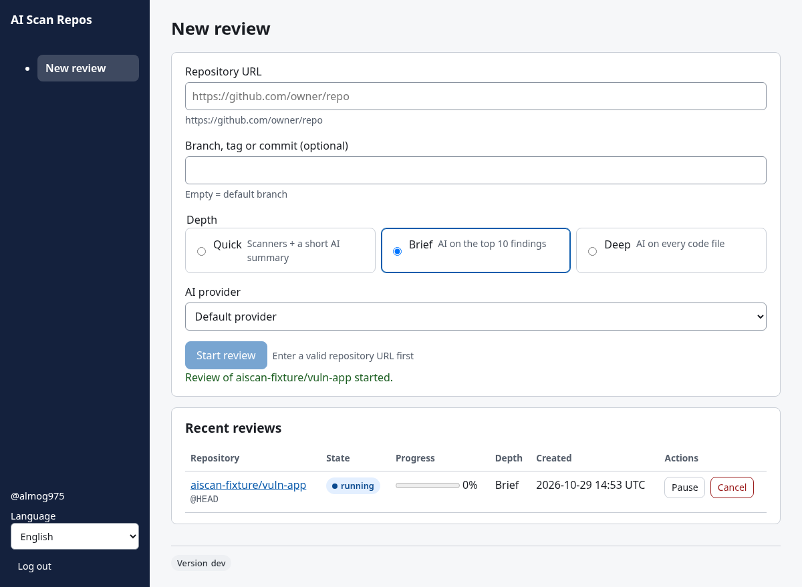
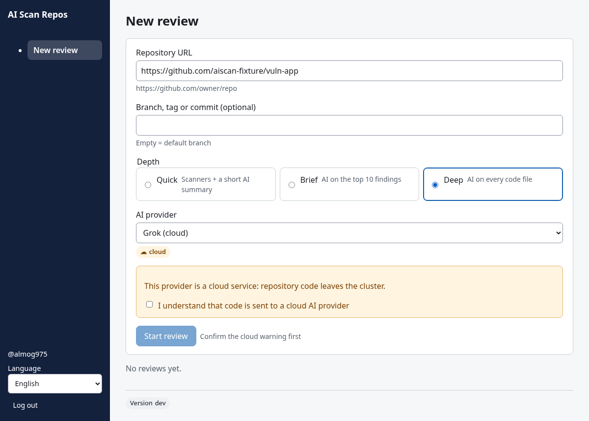
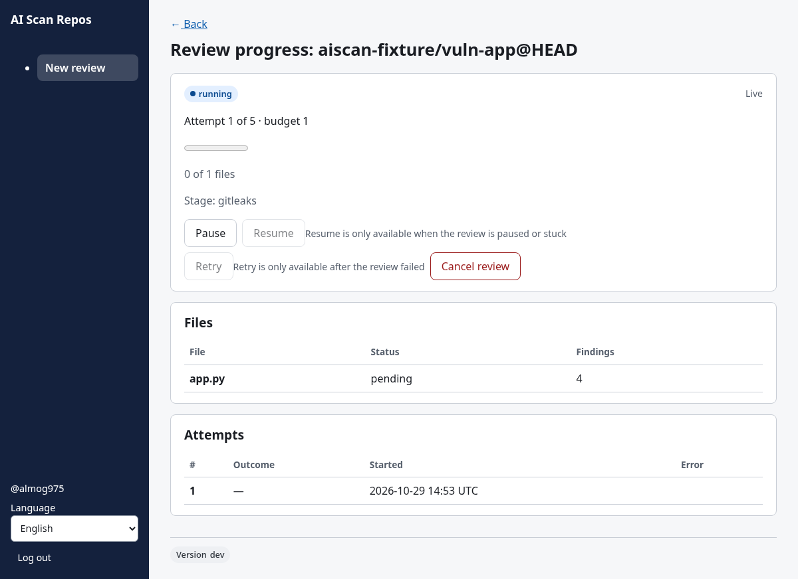
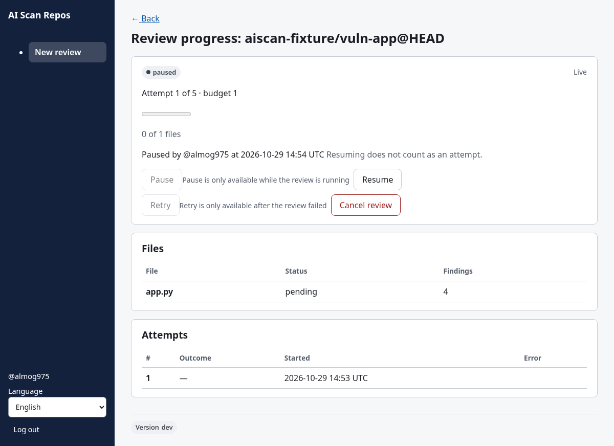
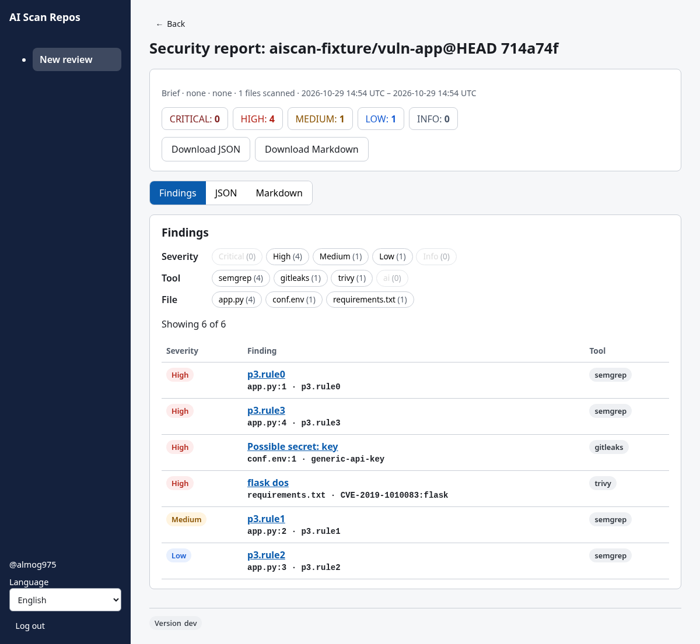

# AI Scan Repos – User Guide

For people who run security reviews of GitHub repositories in the web UI. Operators: [runbook](runbooks/runbook.md). Admins managing AI providers: [admin: AI providers](runbooks/admin-ai-providers.md).

> **Screenshots** were captured with Playwright (headless Chromium) against a **real local stack**: the built SPA under the `frontend/nginx.conf` headers → gateway → review-api (SQLite, local launcher) → scanner-worker, using the full-stack e2e harness (`frontend/e2e/test_fullstack.py`). Only GitHub OAuth and the scanner binaries are stand-ins (a fake GitHub and the test shims), so the findings shown are fixture data. The two providers in the cloud screenshot were inserted directly into the database (no key).

The UI is available in English and Hebrew (language selector in the sidebar / top right). Each step names the API call behind it (gateway `/api/*` → review-api).

---

## 1. Log in



1. Open the app. If you are not signed in you land on **/login** ("Sign in").
2. Click **Log in with GitHub** → GitHub OAuth (`GET /auth/github/login`, scopes `read:user repo`). Approve.
3. GitHub returns to `/auth/github/callback`; the gateway sets the session cookie and the CSRF cookie (`aiscan_csrf`) and redirects to `/`.
4. Your `@login`, the language selector and **Log out** (`POST /auth/logout`) are at the bottom of the sidebar. Admins also see **AI providers** in the sidebar.



Login errors are shown on the login page:
- *"The sign-in link expired or was opened twice."* – OAuth state mismatch; try again.
- *"GitHub did not answer."* – GitHub error; retry in a minute.
- *"Your GitHub account is not allowed to sign in."* – not on the allow-list; ask an admin.

The first user ever to log in becomes `admin`. Sessions expire after `SESSION_TTL_HOURS`.

## 2. Start a review



On **New review** (`/`):

1. **Repository URL** – `https://github.com/<owner>/<repo>` (optional `.git` or trailing `/`). Anything else shows an inline error and **Start review** stays disabled, with the reason next to it.
2. **Branch, tag or commit (optional)** – empty = default branch (sent as `HEAD`).
3. **Depth** – Quick, Brief or Deep (§3).
4. **AI provider** – *Default provider* (the admin's `default_provider_id`; if none is set, scanners only) or an enabled provider from `GET /api/ai-providers`, labelled `(on-prem)` or `(cloud)`.
5. **Start review** → `POST /api/reviews` with `{repo_url, ref, depth, provider_id, ack_cloud}`. A confirmation appears and the review is added to **Recent reviews**.

Errors appear in a box under the form:
- **409** – an active review already exists for this repo and commit; the box links to it.
- **422 CLOUD_ACK_REQUIRED** – cloud provider without confirmation (§3).
- **429 / capacity** – too many reviews running; try later.

## 3. Depth and AI provider



| Depth | Scanners | AI (when a provider is selected) |
|---|---|---|
| **Quick** | Semgrep, Gitleaks, Trivy | Short AI summary (UI: *"Scanners + a short AI summary"*) |
| **Brief** | same | *"AI on the top 10 findings"*: the top 10 findings with code context go to the AI; it fills `ai_fix`, `confidence`, `ai_severity` |
| **Deep** | same | *"AI on every code file"*: AI review of each code file (up to `DEEP_MAX_FILES`, default 40), filling `ai_fix`, `confidence`, `ai_severity` |

With *Default provider* and no default configured by an admin, only the scanners run (the report says *"AI provider: none"*).

> Known limitation: if the admin's default provider is a **cloud** provider, choosing *Default provider* shows no warning, and the request fails with *"CLOUD_ACK_REQUIRED"* (422). Select the cloud provider explicitly and confirm the warning instead.

**Cloud providers.** Each provider is `onprem` or `cloud` (set by an admin). Choosing a cloud provider (e.g. Grok, `api.x.ai`) shows: *"This provider is a cloud service: repository code leaves the cluster."* Until you tick **I understand that code is sent to a cloud AI provider**, **Start review** stays disabled with *"Confirm the cloud warning first"*; ticking it sends `ack_cloud: true`. Without it the API returns 422 `CLOUD_ACK_REQUIRED`. Reports produced with a cloud provider carry a cloud banner (§6). Resuming a cloud review asks again (§5).

## 4. Watch progress



**Recent reviews** (home page) shows repo, state, progress, depth, created time and actions; it updates live (one SSE stream per active review, otherwise polling every 3 s). Click a repository to open its **progress page** (`/reviews/<id>`):

- state badge, attempt (`n of 5`) and budget number;
- files done / total and a progress bar;
- per-state detail: queue position, current file and stage, who paused and when, stuck time, next retry countdown, failure code and next step;
- **Files** table (`GET /api/reviews/{id}/files`) and **Attempts** table (`GET /api/reviews/{id}/attempts`).

Live updates come from `GET /api/reviews/{id}/progress` (Server-Sent Events). If the stream is unavailable the page says *"Live updates unavailable, refreshing every 5 s"* and polls `?format=json`.

### Review states

| State | Meaning | Buttons enabled |
|---|---|---|
| `queued` | Waiting for the scanner Job's first heartbeat | Cancel |
| `running` | Scanning; progress increases | **Pause**, Cancel |
| `paused` | Paused by a user; checkpoint kept | Resume, Cancel |
| `stuck` | No heartbeat for 2 consecutive checks past the threshold | Resume (retry now), Cancel |
| `retrying` | Next attempt scheduled (max 5 per budget) | Cancel |
| `completed` | Done | Open report |
| `failed` | Attempts exhausted or fatal error; code + hint shown | Retry, Open partial report (if any) |
| `cancelled` | Cancelled by a user | Open partial report (if any) |

Disabled buttons show why (e.g. *"Pause is only available while the review is running"*). Full diagram: [review-state-machine.md](diagrams/review-state-machine.md).

## 5. Pause, resume, cancel, retry

- **Pause** – only while `running` (`POST /api/reviews/{id}/pause`).

  
 The worker checkpoints after every file, so finished work is kept.
  From any other state the API returns **409** (invalid state); the UI disables the button.
- **Resume** – from `paused` or `stuck` (`POST /api/reviews/{id}/resume`).
  - paused → `queued`, continues from the checkpoint (does not use an attempt);
  - stuck → `retrying` immediately (next attempt);
  - for a cloud provider a dialog *"Resume with a cloud provider?"* asks you to confirm (**Resume and send code**), which sends `ack_cloud: true`;
  - 422 if the provider was disabled or deleted meanwhile.
- **Cancel** – from any active state, after a confirmation dialog (`POST /api/reviews/{id}/cancel`). Partial results are kept.
- **Retry** – from `failed` (`POST /api/reviews/{id}/retry`); opens a new attempt budget.

Pausing for days is fine – see [resume-after-days.md](runbooks/resume-after-days.md).

## 6. Report and download



**Open report** (or **Open partial report** for failed/cancelled reviews that left one) goes to `/reviews/<id>/report`:

- *"AI analysis by a cloud provider (<name>)."* banner when a cloud provider was used;
- *"Partial report: the review did not finish…"* banner for partial reports;
- depth, provider, files scanned and per-severity counts;
- tabs **Findings** (filter by severity, tool, file), **JSON**, **Markdown**;
- **Download JSON** / **Download Markdown** – `report-<id>.json` / `report-<id>.md` from `GET /api/reviews/{id}/report.json|report.md`.

report.md structure: [report-md-spec.md](report-md-spec.md).

From the command line (with your session cookie):

```bash
curl -b "<session-cookie>=<value>" -o report.md https://<host>/api/reviews/<id>/report.md
```

API responses: **200** report; **409** not completed (or failed/cancelled without a partial report); **410 REPORT_EXPIRED** removed by retention (`REPORT_RETENTION_DAYS`) – the UI shows *"Report expired"* with a link to start a new review.
